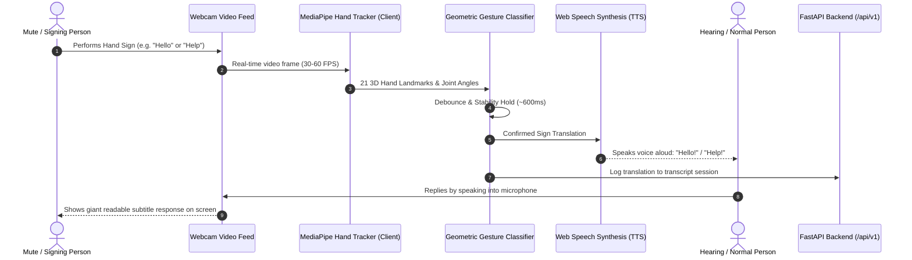

# Implementation Plan - SignBridge AI: Real-Time Hand Tracking & Sign Language Translator

Develop a real-time web application that opens the user's camera, tracks hand landmarks using computer vision, interprets sign language and hand gestures used by mute individuals, and translates them into spoken voice and on-screen text for normal people (with two-way speech-to-text response).

---

## User Review Required

> [!IMPORTANT]
> **Client-Side Computer Vision vs Server Streaming**:
> - We will run **Google MediaPipe Hands** directly inside the browser using client-side WebAssembly / GPU acceleration. This provides **30–60 FPS instant tracking** with zero network latency, ensuring fluid gesture recognition without sending high-bandwidth camera frames to the server.
> - The **FastAPI backend** will manage dictionary configurations, conversation logs/transcripts, and phrase-polishing (converting signed keyword sequences into fluent conversational sentences).

> [!NOTE]
> **Audio & Camera Permissions**:
> - The app utilizes standard browser APIs (`navigator.mediaDevices.getUserMedia` for webcam, `window.speechSynthesis` for text-to-speech voice output, and `webkitSpeechRecognition` for two-way reverse translation). The user must grant camera and microphone permissions when prompted by their browser.

---

## System Architecture & Interaction Flow

---

## Supported Hand Signs & Gestures (Initial Dictionary)

| Category | Gestures / Signs | Meaning / Output |
| :--- | :--- | :--- |
| **Everyday Greetings & Needs** | Open Palm Wave, Flat Palm forward, Thumb Up on Palm, Thumbs Up, Thumbs Down | `"Hello"`, `"Thank You"`, `"Help"`, `"Good / Yes"`, `"Bad / No"` |
| **Common Expressions** | ASL "ILY" (Thumb+Index+Pinky), Peace / V-Sign, Stop Palm, Fist Nod, Call Me (Shaka) | `"I Love You"`, `"Peace / Victory"`, `"Stop / Wait"`, `"Yes"`, `"Call Me"` |
| **Fingerspelling (Alphabet)** | ASL Letters (A, B, C, D, E, F, L, O, V, W, Y) | For spelling names or custom words letter-by-letter |
| **Numbers** | Standard finger counting (1, 2, 3, 4, 5) | Numerical values |

---

## Proposed Changes

### Component 1: Frontend (Next.js - JavaScript)

#### [NEW] `frontend/src/lib/mediapipeLoader.js`
- Dynamically loads Google MediaPipe Hands scripts (`@mediapipe/camera_utils` and `@mediapipe/hands`) into the page via CDN script tags to avoid Turbopack/Next.js WASM worker packaging issues.
- Exports an initialization helper that hooks the webcam video stream to the hand tracking pipeline.

#### [NEW] `frontend/src/lib/gestureClassifier.js`
- Landmark classification logic using 21 3D points:
  - Calculates Euclidean distances between fingertips and palm base.
  - Determines extension state (open, curled, folded) for thumb, index, middle, ring, pinky.
  - Computes pinch distances (e.g., thumb tip to index tip for "OK" / "F").
  - Identifies hand orientation (palm facing forward, upward, inward).
  - Returns detected sign identifier, human-readable label, and confidence score (0–100%).

#### [NEW] `frontend/src/lib/speech.js`
- Web Speech Synthesis wrapper:
  - `speak(text, options)`: Speaks text aloud in natural English.
  - Controls for speech rate, pitch, and voice selection.
  - Web Speech Recognition wrapper (`SpeechToText`) for two-way communication.

#### [NEW] `frontend/src/components/CameraView.js`
- Displays the live video feed with an overlaid HTML5 canvas.
- Renders the hand skeleton in real-time with vibrant cyan/purple glowing joints and landmark lines.
- Shows real-time detection bounding box, active gesture label, and a hold-progress ring.

#### [NEW] `frontend/src/components/TranslationPanel.js`
- Live output console showing:
  - Current detected gesture with confidence meter.
  - Sentence buffer (accumulating signs into full sentences).
  - Controls: "Speak Sentence", "Add Space", "Backspace", "Clear".
  - Audio settings (auto-speak toggle, voice volume, rate).

#### [NEW] `frontend/src/components/TwoWayChat.js`
- Two-way translation bridge for the hearing person:
  - Microphone button that listens to the hearing person speaking.
  - Displays what they said in large, clear, high-contrast cards so the mute person can easily read and reply.

#### [NEW] `frontend/src/components/GestureReferenceModal.js`
- Interactive reference guide showing illustrations and instructions for all supported hand signs so users can learn and practice.

#### [MODIFY] `frontend/src/app/page.js` & `frontend/src/app/globals.css`
- Transform the main page into a sleek, high-tech accessibility dashboard with camera controls, real-time sign recognition canvas, translation readouts, and sound controls.

---

### Component 2: Backend (FastAPI)

#### [NEW] `backend/app/schemas/translation.py`
- Pydantic models for translation logs, session transcripts, and dictionary entries:
  - `TranslationLogCreate`, `TranslationLogResponse`
  - `GestureDefinition` (sign name, description, category, tip)
  - `PhrasePolishRequest`, `PhrasePolishResponse`

#### [NEW] `backend/app/api/v1/endpoints/translation.py`
- `GET /api/v1/translation/dictionary`: Returns list of all supported signs with visual guides and tips.
- `GET /api/v1/translation/history`: Retrieves saved conversation transcript history.
- `POST /api/v1/translation/log`: Records a translated phrase to history.
- `POST /api/v1/translation/polish`: Takes raw sign keywords (e.g., `["HELLO", "HELP", "PLEASE"]`) and turns them into a smooth sentence (`"Hello! Could you please help me?"`).

#### [MODIFY] `backend/app/api/v1/router.py`
- Register the `/translation` router into API v1.

---

## Verification Plan

### Automated / Terminal Checks
1. Verify FastAPI server starts with new translation endpoints:
   - Run `backend\.venv\Scripts\python.exe -c "from app.main import app; print('App loaded with translation endpoints')"`
   - Test endpoints via curl: `GET http://127.0.0.1:8000/api/v1/translation/dictionary`
2. Next.js build verification:
   - Run `npm run build` in `frontend/` to confirm zero JavaScript or build errors.

### Manual / Browser Verification
1. Launch both backend (`python run.py`) and frontend (`npm run dev`).
2. Open `http://localhost:3000` in Google Chrome / Edge.
3. Click **"Start Camera"** and allow webcam access.
4. Test Hand Tracking:
   - Hold hand in front of the camera: verify skeletal landmarks and glowing joints render on the canvas.
5. Test Gesture Recognition & Voice Translation:
   - Perform **"Hello"** (open wave): verify label appears and the computer speaks "Hello" aloud.
   - Perform **"I Love You"** (thumb, index, pinky extended): verify detected and spoken.
   - Perform **"Thumbs Up / Good"**: verify detected and added to sentence.
   - Perform **"Thank You"**: verify detected and spoken.
6. Test Sentence Buffer & Controls:
   - Click "Speak Sentence", "Clear", and verify sentence accumulator works.
7. Test Two-Way Voice-to-Text:
   - Click the microphone icon, speak "How can I help you?", and verify text appears in the mute person's view.
